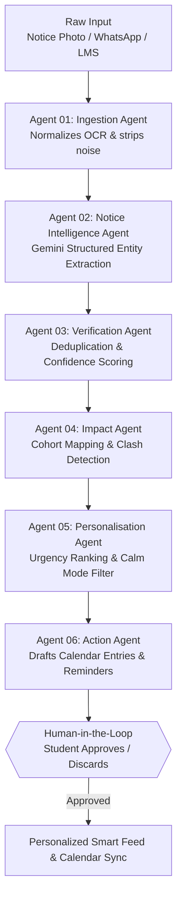

# 🎓 CampusLoop — Your Campus, Understood.
> **One feed. Zero missed.**  
> *An Agentic AI layer that turns scattered campus updates, timetable shocks, and creative opportunities into one personalized, actionable day.*

[](https://genarrative-clash.devfolio.co/overview)
[](#)
[](#)

---

## 📌 1. Project Overview & Hackathon Alignment

College life runs on fragmented information. Students and creators constantly jump between WhatsApp groups, noisy email threads, legacy LMS portals, and physical notice boards.
- **Critical updates get buried** in group chat noise.
- **Deadlines surprise students** because LMS portals don't communicate with personal calendars.
- **Physical notice board photos** cannot be searched or indexed.
- **Student creators spend more time coordinating** than creating.

### 💡 The Solution: 3 Intelligent Moves
1. **UNIFY**: Ingest authorized emails, LMS exports, notice photos, and group chats into a single stream.
2. **UNDERSTAND**: Multi-agent AI extracts who, what, when, and where, eliminates duplicates, verifies source authenticity, and scores confidence.
3. **ACT**: Creates calendar reminders, flags academic clashes, surfaces creator briefs—**with Human-in-the-Loop student approval**.

---

## 🏗️ 2. The 6-Agent Modular Architecture

CampusLoop is built on a specialist agent orchestration pipeline:



1. **Ingestion Agent**: Reads uploaded notice photos (multimodal OCR) or raw forwarded text; strips noise.
2. **Notice Intelligence Agent**: Uses Gemini structured JSON schemas to extract Event Title, Category, Dates, Venues, Cohort, and Action.
3. **Verification Agent**: Deduplicates against existing campus notice vector memory; assigns confidence rating (e.g., `97% Verified`).
4. **Impact Agent**: Matches extracted circular with the active student's department, year, and section. Detects schedule clashes (e.g., assignment vs. event rehearsal).
5. **Personalisation Agent**: Filters out promotional clutter; ranks urgent academic updates to the top.
6. **Action Agent (Human-in-the-Loop)**: Drafts calendar time blocks and reminders. **Never modifies schedules without explicit student approval**.

---

## 🎨 3. CreatorOps Workspace (GeNarrative Track Focus)

CampusLoop includes **CreatorOps**, a dedicated creative engine for campus media clubs, fest leads, and student artists:
- **Creative Brief Inbox**: Turns vague event prompts into structured briefs (Target Audience, Format, Deliverables, Deadlines).
- **Co-Creation Studio**: Generates viral hooks (High Energy, FOMO, Storytelling) and production checklists.
- **Publishing Copilot**: Multi-platform variants with one-click copy (Instagram Reels caption with trending hashtags, LinkedIn professional post, WhatsApp community blast).

---

## 🚀 4. How to Run CampusLoop Locally

CampusLoop is fully self-contained with no heavy node_modules build step required.

### Option A: Open Directly in Browser (Instant)
1. Open File Explorer and navigate to:
   `c:\Users\SUMIT\.vscode\campusloop\`
2. Double-click `index.html` to open it in **Google Chrome**, **Microsoft Edge**, or **Brave**.
3. All views, tabs, agent simulations, and Calm Mode will work immediately!

### Option B: Run via Python Server
Open PowerShell or Command Prompt outside the sandbox:
```bash
cd "c:\Users\SUMIT\.vscode\campusloop"
python server.py
```
Then visit: `https://superlative-queijadas-72b412.netlify.app/`

---

## 🎬 5. 60–90 Second Hackathon Demo Script (For Pitch Video)


| Timestamp | Screen / Action | Voiceover Script |
| :--- | :--- | :--- |
| **00:00 – 00:15** | **Home Hero Screen** | *"This is CampusLoop. Every college student knows the pain of waking up to a room change notice buried in a 500-message WhatsApp group, or missing an assignment deadline because the LMS doesn't talk to their calendar."* |
| **00:15 – 00:35** | **Agent Studio (Live Ingest)** | *Click "Agent Studio" → Click Sample 1 ("Physics Room Change Notice") → Click "Run CampusLoop Agent Pipeline".*<br>*"Watch our 6 specialist agents execute. Ingestion normalizes the notice photo; Notice Intelligence extracts the venue C-110; Verification checks source authority; and Impact Agent detects this affects Sumit, CSE Year 3."* |
| **00:35 – 00:50** | **Human-in-the-Loop & Feed** | *Click "Approve & Add to Student Feed" (confetti triggers).*<br>*"Notice our Human-in-the-Loop guarantee: no schedule is touched without student approval. The moment I approve, it appears live at the top of the Smart Feed."* |
| **00:50 – 01:05** | **Clash Predictor & Calm Mode** | *Highlight the red Clash Alert banner.*<br>*"Our Academic Clash Predictor spots that the DBMS deadline clashes with College Fest tech rehearsal, and suggests a morning time block. And when exam stress peaks, Calm Mode filters out club noise to give a clear, high-impact focus."* |
| **01:05 – 01:25** | **CreatorOps Workspace** | *Switch to CreatorOps tab.*<br>*"For campus artists and fest leads, CreatorOps turns messy briefs into ready-to-shoot hooks and multi-platform captions with a single click."* |
| **01:25 – 01:30** | **Closing** | *"CampusLoop: Your campus, understood. One feed. Zero missed."* |

---

## 👥 Team & Submission Roster
- **Event**: GeNarrative Clash 2026 (Devfolio)
- **Track**: Open Innovation & Creator Support
- **Submission Checkpoint**: 50% MVP Pre-Build (Nov 16, 2026)
- **Live Sprint / Finale**: Nov 21, 2026
